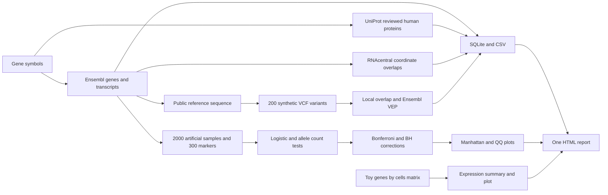
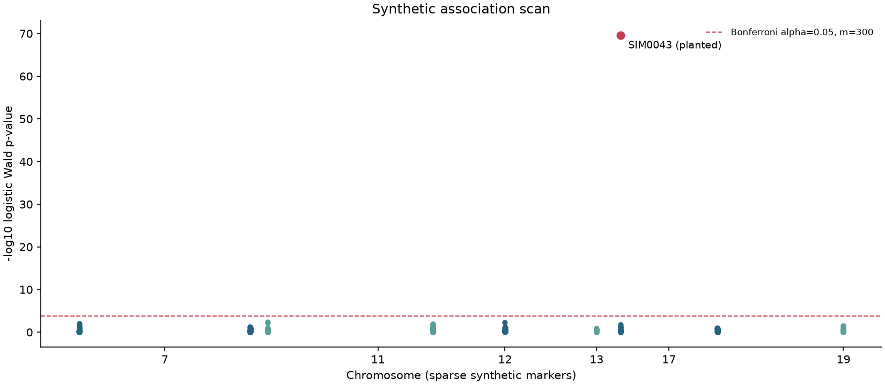

# Gene annotation pipeline lab

A gene-centric Python 3.11 research lab with Ensembl, UniProt and RNAcentral clients, a small VCF reader, Ensembl VEP annotation, synthetic association testing, a toy expression module and one HTML report. Results are written to SQLite and CSV. Public reference annotations are real API data. All variant choices, genotypes, binary traits, sample ids and expression counts in the demonstration are synthetic.

Everything for this task runs in GitHub Actions, including Docker. No PC installation, local Docker, additional account or API key is required. There is no real cohort or real person data.

## Data flow



## Three commands

CI installs the package and runs these stages automatically. In an already prepared environment, these commands replay the committed public responses without using the network:

```sh
gene-lab fetch --config config.yaml --genes data/genes.txt --offline
gene-lab all --config config.yaml --genes data/genes.txt --offline
gene-lab report --config config.yaml --genes data/genes.txt --offline
```

The first command fetches the public annotation snapshot into the output database. The second runs the complete demonstration. The third rebuilds the self-contained HTML report from stored results and the toy expression matrix. The separate `annotate` and `associate` commands are also available. A missing prerequisite stage produces a readable error and nonzero exit status.

Omit `--offline` to use live public APIs with the configured cache. The `recordings`, input paths, output directory, API URLs, cache lifetime, request settings, seed, sample count, marker count, planted index and significance threshold are configured in `config.yaml`. Paths in YAML are resolved relative to that file. The default species and assembly are human GRCh38.

## Public APIs and recordings

The default gene list is BRCA1, BRCA2, TP53, EGFR, CFTR, APOE, HBB, KRAS, MALAT1 and NEAT1. The first capture runs in Actions and saves actual response bodies, source URLs, retrieval times and SHA-256 hashes of the received bytes. The checked-in JSON representation may use different whitespace from those original bytes. It preserves the returned data. Saved responses are reused when a capture resumes after a failure.

The HTTP client uses requests with bounded timeouts, exponential backoff, retries for network errors, HTTP 429 and server errors, Retry-After seconds or HTTP-date handling, request pacing and Ensembl rate-limit reset handling. Permanent client errors are not retried. The SQLite cache has a TTL and separates live and recorded request namespaces. A live request cannot silently consume a replay cache entry.

Ensembl symbol lookup expands transcripts. If that request fails, the client retrieves the basic gene and overlapping transcripts separately and retains transcripts belonging to the requested gene. UniProt uses exact gene-symbol, human and reviewed-entry filters, with at most three returned protein entries per gene. Empty UniProt results for a non-coding gene are expected. RNAcentral is queried for genomic overlap features in each gene region. These may include many features or repeated RNA accessions at different mappings. They are not unique gene-symbol matches, evidence of gene function or proof that a protein-coding gene is non-coding. The report previews at most ten overlap features per gene; the CSV retains all returned features.

Provider status is recorded as ok, empty, error or unavailable. A failed source is not presented as a successful empty search. The report and CSV expose the status. Gene coordinate lookups must succeed before the full simulation can proceed. The standalone fetch command still writes findings for failed symbols.

Public API references: [Ensembl lookup](https://rest.ensembl.org/documentation/info/lookup), [Ensembl reference sequence](https://rest.ensembl.org/documentation/info/sequence_region), [VEP region POST](https://rest.ensembl.org/documentation/info/vep_region_post), [UniProt REST queries](https://www.uniprot.org/help/api_queries), and [RNAcentral API](https://rnacentral.org/api). Ensembl, UniProt and RNAcentral provide the public reference annotations; the repository's simulations do not create or replace those annotations.

## Synthetic VCF

The example has 20 variants in each of ten real gene regions. CI obtains the positive-strand reference sequence from Ensembl and creates arbitrary alternate alleles. The file contains no sample or genotype columns. Its SYN ids identify invented variants, not observed patient variants or known clinical variants. Reference bases and coordinates come from the public GRCh38 sequence.

The parser supports a small VCF subset, including gzip input, multiple ALT alleles and chr prefixes. It checks the header, assembly declaration, positive positions, nucleotide alleles and duplicate allele keys. Missing, reference-equal and unsupported symbolic ALT alleles are skipped with a line-numbered issue. Broken rows and headers produce a filename and line number. MNVs in user input get an explicit MNV label; the demo contains SNVs, insertions and deletions.

Local gene overlap uses the inclusive reference span `POS` to `POS + len(REF) - 1`; insertions use their anchor base. This is a simple span convention, not complete biological indel normalization. Every overlapping selected gene is retained. VEP requests are batched. Returned most-severe consequence terms are sequence-effect predictions, not pathogenicity or clinical classifications. Missing answers and failed requests remain explicit. There is no fabricated VEP answer for a missing response.

## What the association module does

A genome-wide association study, or GWAS, tests whether genetic variants are associated with a measured trait across many people. A signal is an association, not proof of causation. This lab is a small simulation of that testing pattern, not a real GWAS.

The generator creates 2000 unrelated artificial sample rows and 300 independently generated dosage columns taking values 0, 1 or 2. A binary synthetic trait is generated from one marker with a configured additive log-odds effect. The default planted marker is SIM0043. The association markers use positions in the selected gene regions but are a separate dataset from the 200 VCF variants. They must not be interpreted as patient observations or as an association analysis of that VCF.

Each marker is tested with an intercept-plus-dosage logistic regression in statsmodels. The reported logistic p-value is the slope's Wald p-value. A separate chi square test compares reference and alternate allele counts in synthetic cases and controls, without continuity correction. Low expected counts are flagged. The allelic table is a simplified test and does not model within-person allele dependence or covariates.

Bonferroni and Benjamini Hochberg corrections are applied separately to the logistic and chi square p-value families. All configured markers count toward each correction, including failed fits. Monomorphic, separated or unconverged logistic fits retain missing estimates and an explicit status. The full demo checks that the planted marker passes both Bonferroni thresholds. The Manhattan plot uses sparse marker positions, and the QQ plot compares valid logistic p-values with uniform quantiles. Neither plot establishes clinical relevance or validates a real cohort.

The simulation leaves out population and ancestry structure, relatedness, imputation, linkage disequilibrium modeling, covariates, phenotype ascertainment and real quality control such as missingness filters, batch effects, Hardy-Weinberg checks or genotype calling. It is too small and sparse to represent genome-wide coverage. A strong planted signal is a software check, not a scientific discovery.

## Toy single-cell module

The CSV is genes by 24 artificial cell columns. Counts are generated from a simple Poisson model with extra zeros. The module reports mean, median, detection fraction and cell count for each requested gene, with missing genes shown as missing. Negative, nonnumeric or nonfinite counts and duplicate genes or cell columns are rejected. The plot is descriptive. This toy example has no normalization, cell clustering, batch correction, cell-type inference or real single-cell sample data.

## Outputs and tests

The output directory contains `pipeline.sqlite`, CSV tables for genes, transcripts, proteins, non-coding overlap features, provider status, annotated variants, association results and expression summaries, plus simulation metadata and plots. `report.html` embeds the plot images, so the HTML can be opened on its own. Separate PNG files are also saved for export. Public API bundles and recording manifests provide provenance.

Unit tests replay actual recorded API responses with responses. Unrecorded requests fail inside the test transport and cannot reach the network. Tests cover retries, cache expiration, rate limits, malformed responses, missing sources, VCF edge cases, exact allele-count and multiple-testing examples, planted-effect detection, failed regression fits, expression errors, CLI commands and the full offline chain. The live test is marked `live` and skipped unless RUN_LIVE is explicitly set to 1. It is skipped in normal CI.

## Docker and CI

Docker runs only on the GitHub runner for this task. The image installs the Python package and runs the whole pipeline on the committed synthetic inputs and recorded public responses. CI starts that container with networking disabled, verifies output dimensions and planted-effect detection, checks the HTML in Chromium, and uploads the HTML, PNG plots, CSV/SQLite outputs, tests, coverage and logs. Public fixture capture is a separate bootstrap step when recordings are absent; it does not run inside unit tests. Once the recordings are committed, standard CI needs no public API calls for the pipeline.

<!-- CI_METRICS_START -->
| Metric | Measured in CI |
| --- | ---: |
| Passed pytest cases | 76 |
| Live tests intentionally skipped | 1 |
| Line coverage | 98.12% (625 / 637 lines) |
| Failures | 0 |
| Gene regions / transcripts / reviewed proteins | 10 / 363 / 8 |
| RNAcentral overlap features | 16,406 |
| Synthetic VCF alleles with VEP answers | 200 / 200 |
| Artificial samples / association markers | 2000 / 300 |
| Failed logistic fits in the demo | 0 |
<!-- CI_METRICS_END -->

Measured on 6 November 2026 in [CI run 42237477935](https://github.com/hamza2829/gene-annotation-pipeline-lab/actions/runs/42237477935), commit `43b49942d449fa6bd58b1259ee28801b4dfb167b`. The actual [measurement JSON](docs/ci-measurements.json) and [container verification](docs/pipeline-proof.json) are preserved from that run. The planted SIM0043 marker passed both Bonferroni tests; its logistic Bonferroni-adjusted p-value was about `6.68e-68` for this synthetic seed. The container ran with `--network none`, and the report check found ten gene cards, three embedded plots and zero browser errors.

CI requires at least 40 passed tests and at least 85 percent line coverage. The table uses actual JUnit, coverage XML and pipeline outputs. The live test is shown separately. No performance, discovery or predictive-accuracy claim is inferred from coverage or the planted signal.

## Sample plot

This is the actual [CI-generated Manhattan plot](docs/manhattan.png) from the run above. The red point is the deliberately planted effect, not a discovered disease association. The separate [QQ plot](docs/qq.png) and [toy expression plot](docs/expression.png) are also preserved from CI.



## Limitations

All sample-level data is synthetic. There is no real cohort, personal health record or clinical phenotype. The GWAS is simplified, the single-cell module is a toy, and the VCF reader supports a documented subset. No liftover, full VCF normalization, structural-variant annotation, clinical interpretation, population adjustment, imputation or real cohort quality control is included. Public APIs and annotations can change or be unavailable. Recorded mode is a dated snapshot, not a claim of current live service availability. This is a research software demonstration and does not produce diagnoses or clinical recommendations.
